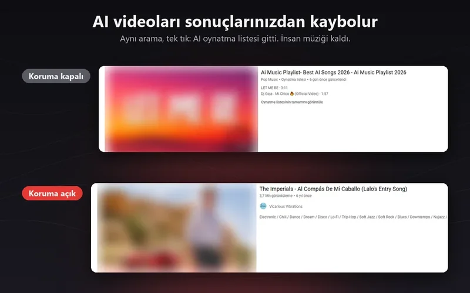
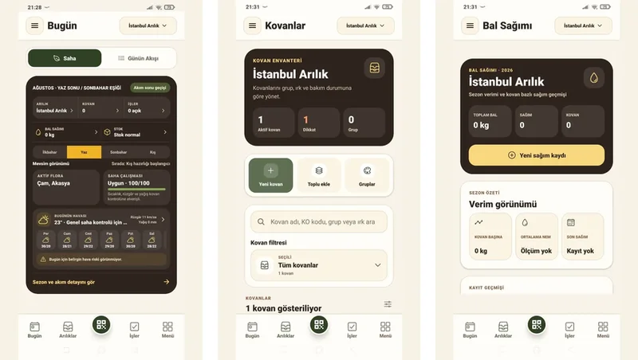
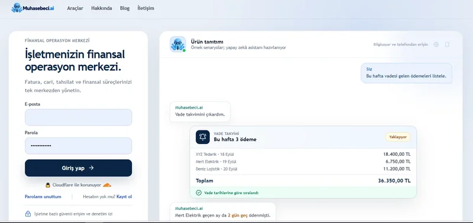
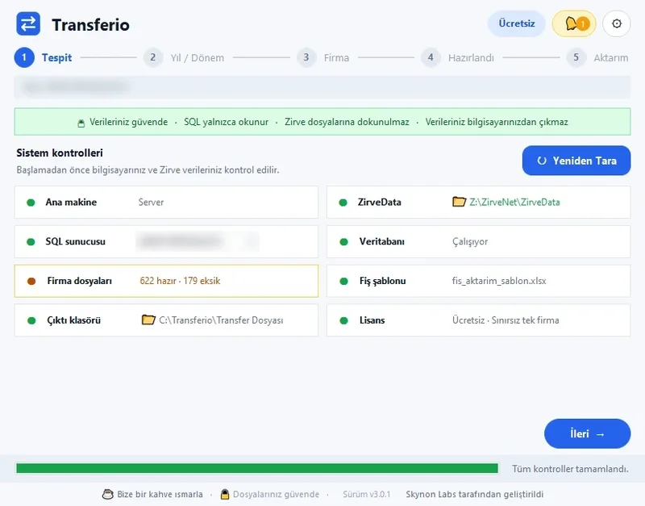
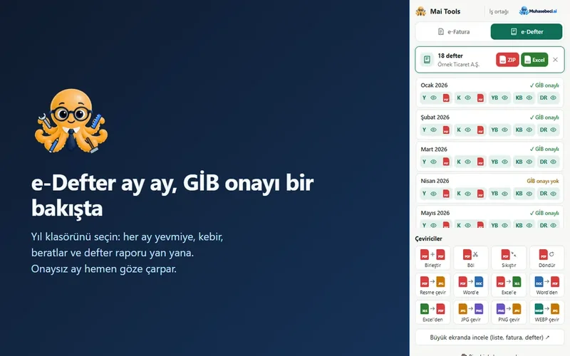
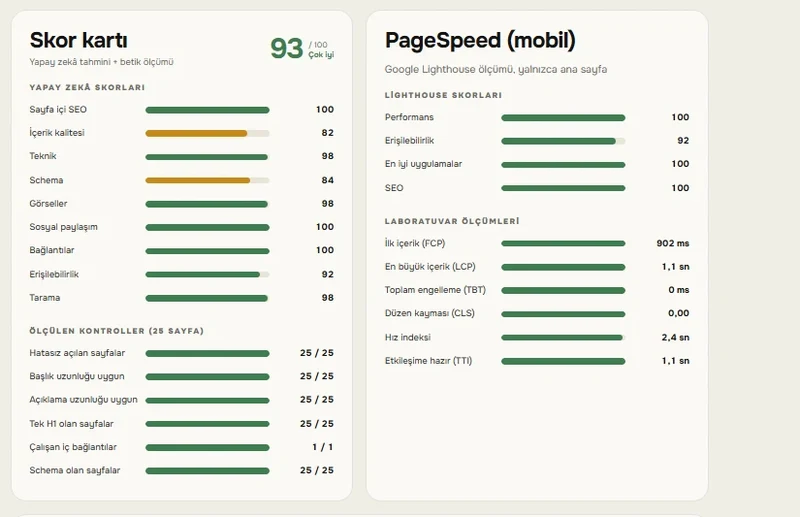

<h2 align="center">Hi, I'm Umut 👋</h2>

<b>Founder of <a href="https://skynonlabs.com/">Skynon Labs</a></b>: browser extensions, mobile apps and SaaS tools, designed and shipped end to end.

<i>Privacy first · few dependencies · tested before every release. Source code is private; each product has a public <b>showcase</b> repo with screenshots and architecture.</i>

---

<table>
<tr>
<td width="50%" valign="top">

<h3>SkorFire Live Football</h3>
Live scores, fixtures, tables and goal notifications in the browser toolbar. New in 2.8.1: team card, share menu, Firefox for Android. No server, no dependencies, 19 languages. 
Manifest V3 · vanilla JS · service worker 
<a href="https://chromewebstore.google.com/detail/apallmfeiokillgdbpedodafkgampneh">Chrome</a> · <a href="https://microsoftedge.microsoft.com/addons/detail/neljlflmnlamhdkdgdpokgiaieplmmia">Edge</a> · <a href="https://addons.mozilla.org/firefox/addon/skorfire-live-football/">Firefox</a> · <a href="https://skynonlabs.com/browser-extensions/skorfire/">Site</a> · <a href="https://github.com/codeXik/skorfire-showcase">Showcase</a>
</td>
<td width="50%" valign="top">

<h3>NoAI for YouTube</h3>
Hides AI-generated videos and AI music using YouTube's own AI labels and title rules in 16 languages. 
Manifest V3 · content filtering · 19 locales 
<a href="https://chromewebstore.google.com/detail/noai-for-youtube/llkofoekoikodncmccnglcifaodnboja">Chrome</a> · <a href="https://microsoftedge.microsoft.com/addons/detail/mflochodlicfjndhphgmdjckanknokcj">Edge</a> · <a href="https://addons.mozilla.org/firefox/addon/noai-for-youtube/">Firefox</a> · <a href="https://github.com/codeXik/noai-youtube-showcase">Showcase</a>
</td>
</tr>
<tr>
<td width="50%" valign="top">

<h3>Kovania</h3>
Beekeeping app: hives, field tasks, weather, flora, harvest, stock and the Beepedia guide. 
Expo · React Native · TypeScript · API backend 
<a href="https://play.google.com/store/apps/details?id=ai.kovania.mobile">Google Play</a> · <a href="https://kovania.com/">Site</a> · <a href="https://github.com/codeXik/kovania-showcase">Showcase</a>
</td>
<td width="50%" valign="top">

<h3>Muhasebeci.ai</h3>
AI-assisted pre-accounting for SMEs: invoices, accounts, collections and due dates, plus free tax calculators. 
TypeScript · Next.js · AI assistant 
<a href="https://muhasebeci.ai/">Live</a> · <a href="https://muhasebeci.ai/araclar">Calculators</a> · <a href="https://github.com/codeXik/muhasebeci-ai-showcase">Showcase</a>
</td>
</tr>
<tr>
<td width="50%" valign="top">

<h3>Transferio</h3>
Windows app for Zirve → Luca accounting data migration: read-only, real pre-flight checks, balanced packages. 
Windows desktop · SQL Server 
<a href="https://skynonlabs.com/transferio.html">Site</a> · <a href="https://github.com/codeXik/transferio-showcase">Showcase</a>
</td>
<td width="50%" valign="top">

<h3>Mai Tools</h3>
Opens Turkish e-invoices and e-ledgers in the browser side panel, converts to PDF and Excel. Data never leaves the device. 
Vite · Preact · Web Workers · Manifest V3 
<a href="https://chromewebstore.google.com/detail/lflikkaafdoihmmnepdhegpkdgdgdofa">Chrome</a> · <a href="https://microsoftedge.microsoft.com/addons/detail/mai-tools/bhdpfmlbgobcecokgdmofhhabdmnopjp">Edge</a> · <a href="https://addons.mozilla.org/firefox/addon/mai-tools/">Firefox</a> · <a href="https://github.com/codeXik/mai-tools-showcase">Showcase</a>
</td>
</tr>
<tr>
<td width="50%" valign="top">

<h3>Skynon SEO</h3>
In-house SEO panel: exact on-page, schema and site checks, mobile PageSpeed, and an AI-written prioritised report. Weekly re-runs. 
Python · FastAPI · SQLite · AI reports 
<a href="https://github.com/codeXik/skynon-seo-showcase">Showcase</a> · <i>internal tool</i>
</td>
<td width="50%" valign="top"></td>
</tr>
</table>

**Open source:** [e-Defter Denetim Merkezi](https://github.com/codeXik/edefter-denetim-merkezi), a pre-audit tool for Turkish e-ledger archives (Python, GPL-3.0). · [tr-vergi](https://github.com/codeXik/tr-vergi), Turkish tax calculators: income tax, VAT withholding, ITO fees (TypeScript, MIT).

### How I build

- **One gateway per external API:** when a source changes, one file changes.
- **"If unsure, don't show it":** unknown states are never presented as facts.
- **Least privilege:** minimal permissions, no trackers, no ads, data stays on the device where possible.
- **Release discipline:** versioned releases, offline tests, store-ready listings in up to 19 languages.

📫 hello@skynonlabs.com · 🌐 [skynonlabs.com](https://skynonlabs.com/) · [Türkçe](README.tr.md)
